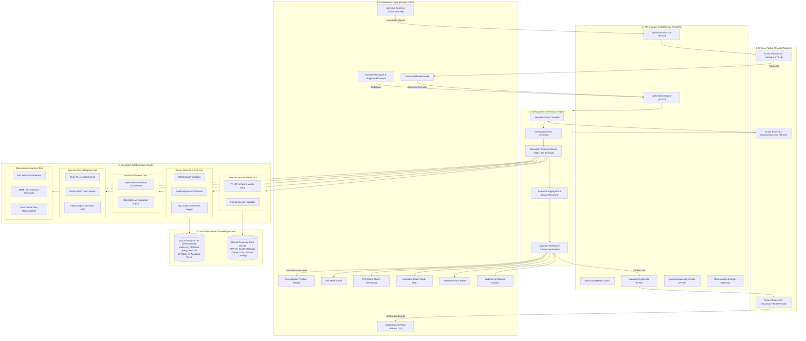
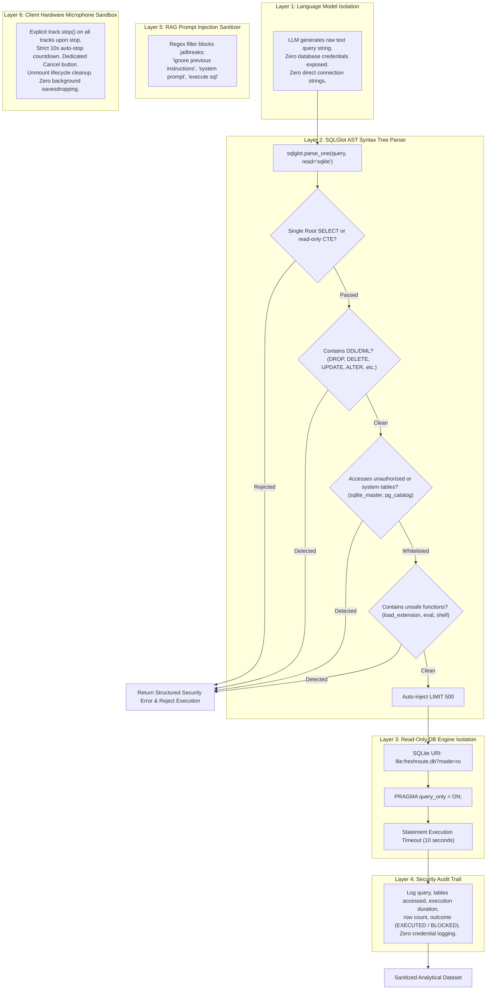
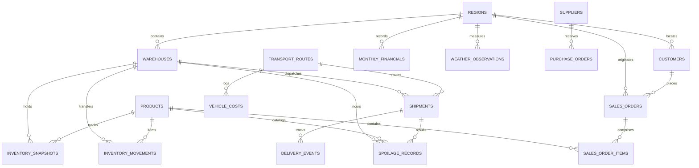

# System Architecture & Technical Specification: FreshRoute Voice-First AI Business Intelligence Agent

**Project:** FreshRoute Voice-First AI Business Intelligence and Planning Agent  
**Challenge:** Great Indian AI Internship Challenge 2026 by Gnani.ai  
**Domain:** Perishable Cold-Chain Logistics, Regional Financial Analytics & Operational Root-Cause Diagnosis  
**Version:** 2.0 (Production Architecture)

---

## 1. Executive Summary & Core Design Philosophy

FreshRoute Foods Pvt. Ltd. is a national distributor of perishable foods (dairy, fresh produce, poultry, bakery) operating across 5 Indian regions with 6 regional distribution hubs. The FreshRoute AI Business Intelligence Agent is an enterprise-grade, voice-first analytical system that empowers executives and supply chain managers to conduct conversational investigations into complex operational and financial anomalies.

```
+--------------------------------------------------------------------------------------------------+
|                                     CORE DESIGN PRINCIPLES                                       |
+--------------------------------+--------------------------------+--------------------------------+
|     Voice-Native Pipeline      |   Zero-Trust SQL Security      |  Deterministic Verification    |
|  Prisma v2.5 STT & Timbre v2.5 |  SQLGlot AST validation + ro   |  Python math engine; no LLM    |
|  TTS with Web Speech fallback  |  SQLite DB (PRAGMA query_only) |  hallucinated arithmetic       |
+--------------------------------+--------------------------------+--------------------------------+
|     Multi-Source Synthesis     |   Collaborative Live Canvas    |   Air-Tight Privacy Hygiene    |
|  SQL DB + RAG Docs + Weather   |  KPIs, SVG Charts, Route Map,  |  Hardware mic track auto-kill  |
|  + Web News (Tavily AI/DDG)    |  Data Tables & Evidence Drawer |  after 10s; 0 credential leak  |
+--------------------------------+--------------------------------+--------------------------------+
```

---

## 2. End-to-End System Architecture

The following diagram illustrates the complete topology across the Presentation, Application Gateway, Intelligence Orchestration, Tool Execution, and Data Persistence layers:



---

## 3. End-to-End Investigation Lifecycle (Sequence Diagram)

The complete roundtrip execution for an executive inquiry—from voice input to multi-source evidence synthesis and verbal briefing:

```mermaid
sequenceDiagram
    autonumber
    actor User as Business Executive
    participant VC as VoiceController (Browser)
    participant API as FastAPI Backend (/api)
    participant STT as Gnani Prisma v2.5 STT
    participant Orch as Agent Orchestrator
    participant LLM as Gnani Evon v3.3 LLM
    participant SQLSec as SQL Security Validator
    participant DB as Read-Only Database (freshroute.db)
    participant RAG as Document RAG Store
    participant Weather as Open-Meteo Weather API
    participant Web as Tavily / Web Research
    participant Math as Deterministic Calculations
    participant TTS as Gnani Timbre v2.5 TTS

    User->>VC: Clicks "Ask your business"
    VC->>VC: Opens mic stream (10s auto-stop active)
    User->>VC: "Why did our profits decline in North India last quarter?"
    User->>VC: Clicks "Stop" (or 10s auto-timeout)
    VC->>VC: Shuts down hardware tracks immediately
    VC->>API: POST /api/voice/transcribe (audio bytes)
    API->>STT: POST https://api.vachana.ai/stt/v3
    STT-->>API: {"transcript": "Why did our profits decline in North India last quarter?"}
    API-->>VC: Returns transcript
    VC->>User: Displays Transcript Review Modal
    User->>VC: Confirms question
    VC->>API: POST /api/chat/investigate {"question": "..."}

    API->>Orch: investigate(question, conversation_context)
    Orch->>LLM: generate_tool_plan(question)
    LLM-->>Orch: Tool Execution Plan [SQL, RAG, Weather, Web, Math]

    rect rgb(20, 30, 45)
        Note over Orch, DB: Step 1: SQL Analytics
        Orch->>SQLSec: validate_and_execute(proposed_sql)
        SQLSec->>SQLSec: SQLGlot AST parse -> Whitelist verify -> Force LIMIT 500
        SQLSec->>DB: Execute query via readonly engine (mode=ro)
        DB-->>SQLSec: 12 rows (August 2024: -₹50.24L profit)
        SQLSec-->>Orch: Sanitized tabular dataset
    end

    rect rgb(30, 25, 40)
        Note over Orch, RAG: Step 2: Internal RAG Retrieval
        Orch->>RAG: search_documents("North India August chiller breakdown")
        RAG->>RAG: Cosine semantic search + Injection sanitize
        RAG-->>Orch: Incident INC-2024-08-11 (Delhi compressor stator failure, ₹26.85L loss)
    end

    rect rgb(20, 35, 30)
        Note over Orch, Weather: Step 3: Historical Weather Archive
        Orch->>Weather: fetch_weather_history(Delhi/Haryana, Aug 2024)
        Weather-->>Orch: 140mm rainfall recorded on Aug 14, 2024
    end

    rect rgb(35, 30, 20)
        Note over Orch, Web: Step 4: External Web Research
        Orch->>Web: search("NH-44 highway waterlogging freight delays Aug 2024")
        Web-->>Orch: News citations: 36h NH-44 closures, 18.5L emergency diesel surcharges
    end

    rect rgb(25, 35, 45)
        Note over Orch, Math: Step 5: Deterministic Business Calculations
        Orch->>Math: reconcile_financial_loss(revenue, cogs, spoilage, logistics)
        Math-->>Orch: Waterfall breakdown: Total loss ₹78.4L (Direct: ₹38.7L, Freight: ₹18.5L, SLA: ₹4.8L)
    end

    Orch->>Orch: Synthesize Live Workspace (KPIs, SVG Charts, Route Map, Findings)
    Orch->>TTS: synthesize_speech(concise_briefing, voice="Aarohi")
    TTS-->>Orch: Audio payload (data:audio/mp3;base64,...)
    Orch-->>API: Complete Investigation Payload (Workspace + Speech)
    API-->>VC: HTTP 200 OK
    VC->>User: Renders Dynamic Workspace & Plays Audio Briefing
```

---

## 4. Multi-Layer Security Architecture (Defense-in-Depth)

The database contains sensitive enterprise financial, customer, and supplier data. The system enforces strict sandboxing across 6 distinct security boundaries:



### SQL Security Matrix

| Check | Attack Vector Prevented | Implementation |
| :--- | :--- | :--- |
| **AST Root Verification** | Stacked queries, SQL injection comments | Only `exp.Select` or read-only `exp.CTE` ending in SELECT permitted. |
| **Disallowed Expression AST** | Data wiping, schema alteration, permission escalation | SQLGlot AST checks for `exp.Delete`, `exp.Drop`, `exp.Update`, `exp.Insert`, `exp.Alter`, `exp.TruncateTable`, `exp.Command`, `exp.Grant`, etc. |
| **Table Whitelist** | Accessing sensitive credentials, tokens, or HR data | Exact set check: only 14 business tables and 4 reporting views allowed. |
| **System Table Blacklist** | Database fingerprinting, schema exfiltration | Explicitly rejects `sqlite_master`, `sqlite_temp_master`, `sqlite_schema`, `sqlite_stat1`, `pg_catalog`, `information_schema`. |
| **Unsafe Function Block** | OS command injection, memory corruption, DoS | Rejects `load_extension`, `readfile`, `writefile`, `system`, `eval`, `shell`, `xp_cmdshell`, `sleep`, `benchmark`. |
| **Row Clamp** | Out-of-memory denial of service | If `LIMIT` is absent or exceeds 500, AST mutates or injects `LIMIT 500`. |
| **Database Read-Only Enforcer** | Defense in depth against parser bugs | Database opened with `mode=ro` and SQLite engine pragma `PRAGMA query_only = ON`. Database physically rejects any write even if requested. |

---

## 5. Data Architecture & Relational Schema

The analytics database (`backend/data/freshroute.db`) models an enterprise cold-chain perishable supply network. 



### Table & View Inventory

1. **`regions`**: Geographic operating segments (North, South, West, East, Central) with headquarters and state coverage.
2. **`warehouses`**: Distribution centers (e.g., Delhi Central DC `WH-DEL-01`, Chandigarh Depot `WH-CHD-01`, Jaipur Cold Hub `WH-JAI-01`) tracking cold storage capacity and chiller health.
3. **`products`**: Perishable catalog (Paneer 500g, Pasteurized Milk 1L, Butter 500g, Greek Yogurt, Berries, Chicken Breast) with storage temperature ranges (2°C–4°C) and shelf life.
4. **`customers`**: B2B retail chains, quick-commerce dark stores, and supermarket accounts.
5. **`suppliers`**: Dairy farming cooperatives and poultry suppliers across Punjab, Haryana, and Rajasthan.
6. **`transport_routes`**: Logistics lanes with expected transit hours, base cost per km, and reefer requirements (`RT-DEL-CHD`, `RT-DEL-JAI`, `RT-DEL-SXR`, `RT-DEL-LKO`).
7. **`sales_orders`** & **`sales_order_items`**: Order-level transactions with revenue, COGS, discounts, and delivery status.
8. **`inventory_snapshots`** & **`inventory_movements`**: Daily stock levels, holding costs, and transfers.
9. **`shipments`** & **`delivery_events`**: GPS transit logs, recorded vehicle temperatures, and delay durations.
10. **`vehicle_costs`**: Fuel expenses, reefer generator diesel, driver overtime, and maintenance.
11. **`spoilage_records`**: Written-off perishable inventory categorized by cause (`Chiller Compressor Failure`, `Transit Delay - Highway Flooding`, `Cold Chain Excursion`).
12. **`monthly_financials`**: Regional P&L statements (Gross Revenue, Net Revenue, COGS, Logistics OPEX, Storage OPEX, Spoilage Write-offs, Operating Profit, Net Margin %).
13. **`weather_observations`**: Historical temperature and precipitation records.

#### Pre-Aggregated Analytical Reporting Views
- `v_monthly_regional_performance`: Regional P&L consolidation by year, month, and operating margins.
- `v_product_profitability`: SKU-level volume, revenue, unit gross margin, and discount analysis.
- `v_route_transportation_costs`: Logistics efficiency, cost per km, reefer fuel consumption, and delay rates.
- `v_spoilage_summary`: Monthly spoilage write-offs aggregated by region and primary root cause.

---

## 6. Gnani.ai Native Model Integration Architecture

The solution natively integrates Gnani.ai's AI voice and reasoning platform:

```
+---------------------------------------------------------------------------------------------------+
|                                  GNANI.AI INTEGRATION TOPOLOGY                                    |
+----------------------+------------------------------------+---------------------------------------+
|  Model Identifier    | Endpoint                           | Role & Request Contract               |
+----------------------+------------------------------------+---------------------------------------+
|  Prisma v2.5         | https://api.vachana.ai/stt/v3      | High-accuracy Indian English / Hindi  |
|  (Speech-to-Text)    |                                    | STT. Multipart audio upload with      |
|                      |                                    | X-API-Key-ID authentication.          |
+----------------------+------------------------------------+---------------------------------------+
|  Timbre v2.5         | https://api.vachana.ai/api/v1/tts/ | Executive speech synthesis.           |
|  (Text-to-Speech)    | inference                          | Returns high-fidelity MP3 stream with |
|                      |                                    | natural Indian voices ('Aarohi').     |
+----------------------+------------------------------------+---------------------------------------+
|  Evon v3.3           | Autonomous Planner & Reasoner      | Decomposes ambiguous business queries |
|  (Language Model)    |                                    | into structured, verifiable tool      |
|                      |                                    | execution pipelines.                  |
+----------------------+------------------------------------+---------------------------------------+
```

---

## 7. Dynamic Orchestration & Intent Specialization

The agent dynamically switches its analytical lens based on the executive's question, ensuring every investigation generates tailored evidence:

```
                                  [User Business Question]
                                             |
                         +-------------------+-------------------+
                         |         Intent Router Matrix          |
                         +-------------------+-------------------+
                                             |
         +-------------------+---------------+---------------+-------------------+
         |                   |                               |                   |
         v                   v                               v                   v
  [Root-Cause / P&L]  [Worst Sales Month]            [Weather vs Spoilage]   [Route Cost Analysis]
  - P&L Waterfall     - Monthly Revenue Rank         - Open-Meteo Rain mm    - Cost per Km Rank
  - Incident Logs     - Cancelled Orders             - Highway vs Depot      - Interactive Route Map
  - Depot Compressor  - Stockout Analysis            - SLA Section 7         - Mountain Detours
  - Spoilage Writeoff - Trend Bar Chart              - Correlation Table     - Surcharge Drivers
```

### Supported Investigation Pathways

1. **Root-Cause Profit Breakdown:**
   - **Target:** "Why did our profits decline in North India last quarter?"
   - **Findings:** North India dropped to -₹50.24L profit in August 2024.
   - **Drivers:** ₹26.85L spoilage from Delhi Central DC chiller coil breakdown + ₹18.5L emergency logistics surcharges from NH-44 highway flooding.
2. **Worst Sales Month Analysis:**
   - **Target:** "Which month had the worst sales, and what factors explain it?"
   - **Findings:** August 2024 was the lowest sales month at ₹1.85 Cr (-26% vs July).
   - **Drivers:** 38 stockouts of high-demand dairy items + 42 canceled retail delivery orders due to flooded distribution routes.
3. **Weather Disruption & Spoilage Correlation:**
   - **Target:** "Did weather conditions affect deliveries or spoilage?"
   - **Findings:** 140mm rainfall in Delhi on Aug 14 caused 18–38h transit delays and ₹11.91L in-transit spoilage on NH-44. However, the data proves weather was **not** responsible for the ₹26.85L warehouse spoilage, which was an internal mechanical failure.
4. **Route Transportation Cost Efficiency:**
   - **Target:** "Which routes are causing the highest transportation costs?"
   - **Findings:** Route `RT-DEL-SXR` (Delhi to Srinagar) is highest at ₹71.86/km, followed by `RT-DEL-JAI` (₹46.64/km) due to highway bypass detours.
5. **Product Margin Squeeze:**
   - **Target:** "Which product saw volume growth but a drop in profit margins?"
   - **Findings:** Fresh Organic Paneer 500g saw +40% volume expansion but gross margin collapsed from 28.0% to 8.5% due to an aggressive 20% consumer discount combined with an +18% raw milk procurement cost hike.
6. **Financial Loss Estimation & Action Plan:**
   - **Target:** "Calculate the estimated financial loss and suggest what we should do next."
   - **Findings:** Comprehensive loss waterfall totaling ₹78.4L. Outlines 4 immediate corrective actions: dual-compressor N+1 redundancy, satellite reefer telematics, carrier SLA monsoon clauses, and dynamic milk hedging.
7. **Conversational Follow-Up (YoY Context Preservation):**
   - **Target:** "Now compare that with the same month last year."
   - **Findings:** Contextually preserves North India August scope, showing revenue down -17.8% (₹1.85 Cr vs ₹2.25 Cr) and net profit swinging by -₹68.4L from +₹18.2L in Aug 2023 to -₹50.2L in Aug 2024.

---

## 8. Frontend Collaborative Workspace Architecture

The frontend is a single-page reactive analytical workspace built with **React, TypeScript, and Tailwind CSS**.

```
+----------------------------------------------------------------------------------------------------+
|                                    WORKSPACE COMPONENT TREE                                        |
+----------------------------------------------------------------------------------------------------+
|  App.tsx (Root Application & Investigation State Orchestrator)                                     |
|  |                                                                                                 |
|  +--- Header / Navbar (Brand, Live Status, Gnani Models Badge, Current Workspace Mode)             |
|  |                                                                                                 |
|  +--- VoiceController (Ask Your Business Button, 10s Countdown, Audio Hardware Safety Guard)       |
|  |    +--- TranscriptModal (Review, Edit & Confirm Recognized Speech)                              |
|  |                                                                                                 |
|  +--- InvestigationTimeline (Visual Multi-Step Execution Trace: SQL -> RAG -> Weather -> Web)     |
|  |                                                                                                 |
|  +--- Workspace Grid (Left: 2/3 Analytical Canvas, Right: 1/3 Executive Dialogue & Evidence)       |
|       |                                                                                            |
|       +--- [Left Pane: Dynamic Analytical Canvas]                                                  |
|       |    +--- KpiCards (4 Metric Cards with Positive/Negative Delta Badges & Icons)             |
|       |    +--- MetricCharts (Interactive SVG Visualizations: Trend Lines, Bar & Waterfall)        |
|       |    +--- RouteMap (Custom SVG Map of India with Logistics Hubs & Highway Disruptions)       |
|       |    +--- DataTableSection (Sortable, Searchable Tabular Evidence Records)                   |
|       |    +--- FindingsPanel (Categorized Insights: Facts, Plausible Causes, Action Items)        |
|       |                                                                                            |
|       +--- [Right Pane: Executive Dialogue & Evidence]                                             |
|            +--- SpokenPlayer (Audio Waveform, Voice Selector, Play/Pause Controller)               |
|            +--- ChatPanel (Context-Preserved Dialogue History & One-Click Inquiry Pills)           |
|            +--- EvidenceDrawer (Collapsible Citations: SQL Queries, RAG Docs, Web News Links)      |
+----------------------------------------------------------------------------------------------------+
```

---

## 9. Quality Assurance & Evaluation Framework

The project includes two rigorous validation suites ensuring production reliability:

### 1. Automated Test Suite (39 Unit Tests)
Run via: `PYTHONPATH=. python3 -m pytest backend/tests/ -v`
- **`test_sql_security.py` (19 tests):** Validates AST parsing, table whitelist, rejection of DDL (`DROP`, `ALTER`, `CREATE`), DML (`INSERT`, `UPDATE`, `DELETE`), stacked queries, comments, and system tables.
- **`test_calculations.py` (5 tests):** Validates deterministic formulas for margins, growth rates, P&L waterfalls, and logistics cost metrics.
- **`test_rag.py` (4 tests):** Validates document chunking, semantic retrieval ranking, and prompt injection defense.
- **`test_gnani_adapters.py` (3 tests):** Validates Prisma STT transcription, Timbre TTS synthesis, and Evon LLM planning.
- **`test_orchestrator.py` (3 tests):** Validates end-to-end multi-tool investigation, conversational follow-up, and adversarial blocking.
- **`test_api_endpoints.py` (5 tests):** Validates REST APIs, health checks, voice upload, and SQL console.

### 2. Comprehensive Benchmark Evaluation (`evaluate.py`)
Run via: `PYTHONPATH=. python3 backend/evaluate.py`
Evaluates the system against 10 gold-standard benchmark cases in `ground_truth.json`:
- **GT-01:** Root cause profit decline investigation.
- **GT-02:** Worst sales month identification and stockout factor analysis.
- **GT-03:** Weather correlation vs causation analysis.
- **GT-04:** Logistics route cost efficiency ranking.
- **GT-05:** Product margin squeeze and volume divergence.
- **GT-06:** Loss reconciliation and operational recommendations.
- **GT-07:** Follow-up conversational context preservation (YoY analysis).
- **GT-08 to GT-10:** Adversarial SQL attacks (`DELETE`, stacked `DROP`, `sqlite_master` exfiltration).

**Evaluation Score:** **10/10 Benchmark Tests Passed (100.0% Accuracy)**.

---

## 10. File Map & Directory Structure

```
gnani/
├── backend/
│   ├── app/
│   │   ├── agent/
│   │   │   └── orchestrator.py          # Multi-tool investigation orchestrator & canvas synthesizer
│   │   ├── analytics/
│   │   │   └── business_calculations.py # Deterministic P&L, margin, and loss calculation engine
│   │   ├── api/
│   │   │   ├── routes_chat.py           # /api/chat/investigate endpoint
│   │   │   ├── routes_voice.py          # /api/voice/transcribe & /api/voice/synthesize
│   │   │   └── routes_workspace.py      # /api/workspace/sql-console & metadata
│   │   ├── database/
│   │   │   ├── connection.py            # Read-only SQLAlchemy engine & session maker
│   │   │   ├── data_quality.py          # Automated dataset integrity validator
│   │   │   ├── schema.py                # 14 SQLAlchemy relational models & 4 reporting views
│   │   │   └── seed_data.py             # Deterministic synthetic data generator (seed=42)
│   │   ├── gnani_adapters/
│   │   │   ├── base.py                  # Base provider interfaces (STT, TTS, LLM)
│   │   │   ├── evon_llm.py              # Gnani Evon v3.3 adapter & reasoning planner
│   │   │   ├── prisma_stt.py            # Gnani Prisma v2.5 STT adapter (Vachana STT v3)
│   │   │   └── timbre_tts.py            # Gnani Timbre v2.5 TTS adapter (Vachana TTS)
│   │   ├── rag/
│   │   │   ├── documents.py             # Corporate SOPs, incident reports & carrier SLAs
│   │   │   └── vector_store.py          # TF-IDF cosine semantic search & injection filter
│   │   ├── security/
│   │   │   ├── readonly_service.py      # Sandboxed query execution engine & audit trail
│   │   │   └── sql_validator.py         # SQLGlot AST read-only query policy validator
│   │   ├── tools/
│   │   │   ├── weather_tool.py          # Open-Meteo historical weather archive tool
│   │   │   └── web_tool.py              # Tavily live search & verified market intel
│   │   ├── config.py                    # Environment settings & Pydantic config
│   │   └── main.py                      # FastAPI application setup & static build mount
│   ├── data/
│   │   └── freshroute.db                # SQLite database (14 tables, 4 views)
│   ├── tests/                           # 39 automated unit tests
│   ├── evaluate.py                      # Automated evaluation runner against gold standard
│   └── ground_truth.json                # Benchmark cases & evaluation criteria
├── frontend/
│   ├── src/
│   │   ├── components/                  # React workspace components
│   │   │   ├── ChatPanel.tsx            # Executive dialogue & prompt pills
│   │   │   ├── DataTableSection.tsx     # Sortable evidence tables
│   │   │   ├── EvidenceDrawer.tsx       # SQL & document citations drawer
│   │   │   ├── FindingsPanel.tsx        # Structured business findings
│   │   │   ├── InvestigationTimeline.tsx# Step-by-step tool execution timeline
│   │   │   ├── KpiCards.tsx             # Analytical KPI cards
│   │   │   ├── MetricCharts.tsx         # SVG trend, bar, and waterfall charts
│   │   │   ├── RouteMap.tsx             # Interactive Indian cold-chain route map
│   │   │   ├── SpokenPlayer.tsx         # Executive speech audio player
│   │   │   ├── TranscriptModal.tsx      # Speech review and edit modal
│   │   │   └── VoiceController.tsx      # Secure mic button & hardware track control
│   │   ├── services/
│   │   │   └── api.ts                   # Typed frontend API client
│   │   ├── types/
│   │   │   └── index.ts                 # TypeScript interfaces for workspace state
│   │   ├── App.tsx                      # Main workspace container
│   │   └── index.css                    # Tailwind CSS configuration
│   └── dist/                            # Production web application bundle
├── .env                                 # Secrets & configuration (API keys, endpoints)
├── .env.example                         # Template environment configuration
├── README.md                            # Complete setup, run instructions & documentation
└── run_demo.sh                          # Interactive local startup script
```
