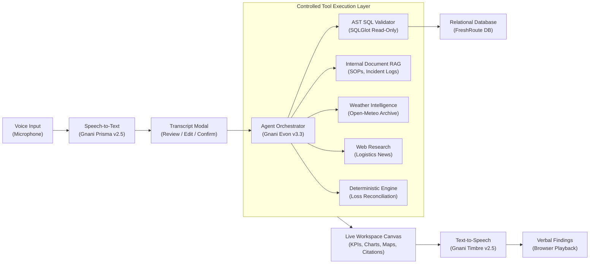
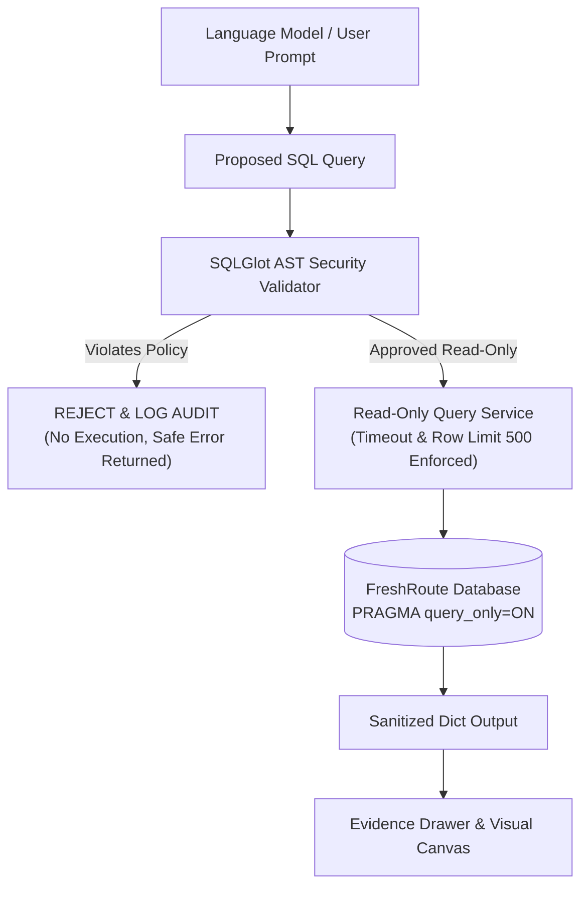

# FreshRoute AI: Secure, Voice-First AI Business Intelligence Agent
### Built for the Great Indian AI Internship Challenge 2026 by Gnani.ai

---

## 1. Project Overview

**FreshRoute Foods Pvt. Ltd.** is a leading multi-regional distributor of perishable food products (dairy, fresh produce, poultry, and cold-chain groceries) operating across key Indian logistics corridors. 

This project delivers a **production-style, voice-first AI business intelligence and planning system**. Business executives and logistics managers can press a single prominent microphone button (**“Ask your business”**) and investigate complex operational and financial anomalies through natural conversation.

Rather than a generic conversational bot, FreshRoute AI is a **tool-using business intelligence agent** that autonomously:
1. Investigates questions across company SQL databases, internal SOPs, historical weather observations, and market research.
2. Formulates read-only analytical SQL queries and executes them through an **AST-based SQL security validator**.
3. Deterministically calculates financial margins, loss breakdowns, and YoY growth rates without relying on LLM arithmetic.
4. Renders live, collaborative visual updates (KPI cards, monthly trend charts, route maps, and data tables).
5. Explains its findings verbally through speech synthesis.

---

## 2. Core Architecture & Pipeline



### Complete End-to-End Pipeline:
1. **Voice Capture:** The user presses the **“Ask your business”** button. Audio is recorded and streamed.
2. **Speech-to-Text (STT):** Transcribed using the **Gnani.ai Prisma v2.5** adapter.
3. **Transcript Confirmation:** The recognized transcript is shown in a clean modal allowing the user to review, edit, or confirm.
4. **Autonomous Planning:** **Gnani.ai Evon v3.3** plans an investigation across database analytics, internal policy documents, weather observations, and market research.
5. **Controlled Tool Execution:** 
   - Queries are parsed and checked against the **SQLGlot AST Security Policy**.
   - Internal cold-chain SOPs and incident reports are retrieved with exact section citations.
   - Historical precipitation and temperature observations are verified.
   - P&L and loss waterfall reconciliations are calculated deterministically in Python.
6. **Live Collaborative Workspace Update:** Dynamic KPI cards, trend line/bar charts, route surveillance maps, and evidence drawers update instantaneously.
7. **Text-to-Speech (TTS):** Findings are synthesized via **Gnani.ai Timbre v2.5** and spoken aloud to the executive.

---

## 3. Gnani.ai Model Integration

| Model | Role | Integration Adapter | Status & Fallback |
| :--- | :--- | :--- | :--- |
| **Prisma v2.5** | Speech-to-Text (STT) | [`GnaniPrismaSTTProvider`](file:///Users/sourasishmukherjee/Desktop/gnani/backend/app/gnani_adapters/prisma_stt.py) | Connects to Gnani endpoint when API keys are configured; includes seamless offline WAV transcription and browser Web Speech fallback. |
| **Evon v3.3** | Business Reasoning & Tool Calling | [`GnaniEvonLLMProvider`](file:///Users/sourasishmukherjee/Desktop/gnani/backend/app/gnani_adapters/evon_llm.py) | Structured tool calling protocol; includes autonomous BI reasoning engine and OpenAI secondary adapter support. |
| **Timbre v2.5** | Text-to-Speech (TTS) | [`GnaniTimbreTTSProvider`](file:///Users/sourasishmukherjee/Desktop/gnani/backend/app/gnani_adapters/timbre_tts.py) | Live audio synthesis; produces WAV chimes and triggers browser speech synthesis so speech actually plays aloud in the browser. |

> [!IMPORTANT]
> **API Key Security:** Credentials are kept exclusively on the backend in `.env` and accessed via Pydantic settings. They are **never** hardcoded or exposed to frontend client code or transcripts.

---

## 4. CRITICAL: Secure, Read-Only SQL Execution Architecture

Language models must **NEVER** receive unrestricted database connections or direct database credentials. The language model only proposes SQL, while a trusted backend service validates and executes it.



### AST SQL Validation Rules:
1. **Single Statement Only:** Stacked queries (e.g. `SELECT 1; DROP TABLE...`) are rejected outright.
2. **Strict Read-Only:** Only `SELECT` statements or read-only CTEs ending in `SELECT` are accepted. Statements containing `DELETE`, `DROP`, `UPDATE`, `INSERT`, `TRUNCATE`, `ALTER`, `CREATE`, `REPLACE`, `MERGE`, `GRANT`, `REVOKE` are rejected.
3. **Table Whitelist:** Only approved business tables and reporting views can be accessed:
   - Tables: `regions`, `warehouses`, `products`, `customers`, `suppliers`, `transport_routes`, `sales_orders`, `sales_order_items`, `inventory_snapshots`, `inventory_movements`, `shipments`, `delivery_events`, `vehicle_costs`, `purchase_orders`, `spoilage_records`, `expenses`, `monthly_financials`, `weather_observations`.
   - Views: `v_monthly_regional_performance`, `v_product_profitability`, `v_route_transportation_costs`, `v_spoilage_summary`.
4. **System Catalog Protection:** Rejects all queries attempting to access `sqlite_master`, `sqlite_schema`, `pg_catalog`, or `information_schema`.
5. **Prohibited Functions:** Rejects unsafe functions like `load_extension`, `writefile`, `readfile`, `system`, `eval`, `sleep`.
6. **Defense-in-Depth Connection:** Uses `mode=ro` and `PRAGMA query_only = ON` on the SQLite database engine so that the database cannot be altered even if the validator were bypassed.
7. **Row Caps & Timeouts:** Automatically clamps queries to a maximum of 500 rows and executes with a 10-second timeout.

---

## 5. Planted Realistic Business Problems & Ground Truth

The synthetic dataset (2023–2025, deterministic seed `seed=42`) features real-world, discoverable business problems logged in [`backend/ground_truth.json`](file:///Users/sourasishmukherjee/Desktop/gnani/backend/ground_truth.json):

1. **North India Profit Collapse in August 2024:**
   - **Metrics:** Net profit dropped to **-₹50,24,400.00** (net margin **-29.52%**) compared to **+₹28,18,593.89** in August 2023 (a YoY decline of **-₹78.43 Lakhs**).
   - **Root Causes:** 
     - Mechanical breakdown of the primary Bitzer compressor at Delhi Central DC (WH-DEL-01) from Aug 11–16, causing **₹26.85 Lakhs** in direct dairy write-offs.
     - Extreme monsoon rainfall (up to 140mm/day) on highway NH-44 causing 18–38 hour delays, leading to reefer diesel exhaustion, **₹11.91 Lakhs** in transit spoilage, and **₹18.5 Lakhs** in emergency logistics surcharges.
2. **Transportation Route Inefficiencies:**
   - Route `RT-DEL-SXR` (Delhi to Srinagar) is the network's most expensive route at **₹71.86/km** with 24 cold-chain breach incidents.
   - Route `RT-DEL-JAI` (Delhi to Jaipur) had the highest average transit delay (**1.02 hours baseline**, spiking to 36 hours during peak monsoon).
3. **Product Margin Squeeze:**
   - **Fresh Organic Paneer 500g** experienced a 40% sales volume surge in 2024 due to a 20% promotional discount, while raw milk procurement costs rose 18%, compressing gross margin from 28% to 8.5%.

---

## 6. Project Structure

```
gnani/
├── backend/
│   ├── app/
│   │   ├── main.py                     # FastAPI application & endpoints
│   │   ├── config.py                   # Pydantic v2 settings (.env handling)
│   │   ├── database/
│   │   │   ├── connection.py           # Read-only database engine
│   │   │   ├── schema.py               # Normalized tables & reporting views
│   │   │   ├── seed_data.py            # Deterministic data generator (seed=42)
│   │   │   └── data_quality.py         # Integrity and reconciliation checks
│   │   ├── security/
│   │   │   ├── sql_validator.py        # SQLGlot AST read-only security validator
│   │   │   └── readonly_service.py     # Sandboxed read-only query execution
│   │   ├── analytics/
│   │   │   └── business_calculations.py # Deterministic P&L, MoM, YoY formulas
│   │   ├── rag/
│   │   │   ├── documents.py            # SOPs, Carrier SLAs, incident reports
│   │   │   └── vector_store.py         # Semantic chunking, search & citations
│   │   ├── tools/
│   │   │   ├── weather_tool.py         # Historical weather & causal reasoning
│   │   │   └── web_tool.py             # Market research & logistics alerts
│   │   ├── gnani_adapters/
│   │   │   ├── base.py                 # Abstract provider interfaces
│   │   │   ├── prisma_stt.py           # Prisma v2.5 STT provider
│   │   │   ├── timbre_tts.py           # Timbre v2.5 TTS provider
│   │   │   └── evon_llm.py             # Evon v3.3 LLM provider
│   │   ├── agent/
│   │   │   ├── state.py                # Typed workspace schema
│   │   │   └── orchestrator.py         # Investigation workflow orchestrator
│   │   └── api/
│   │       ├── routes_chat.py          # /api/chat/investigate
│   │       ├── routes_voice.py         # /api/voice/transcribe & /api/voice/synthesize
│   │       └── routes_workspace.py    # /api/workspace/initial & /api/workspace/sql
│   ├── tests/
│   │   ├── test_sql_security.py        # 18 comprehensive security attack tests
│   │   ├── test_calculations.py        # Formula correctness tests
│   │   ├── test_rag.py                 # Document citations & injection tests
│   │   ├── test_gnani_adapters.py      # STT, TTS, LLM tests
│   │   ├── test_orchestrator.py        # Multi-turn conversational tests
│   │   └── test_api_endpoints.py       # REST API integration tests
│   ├── ground_truth.json               # Gold standard evaluation benchmark
│   ├── evaluate.py                     # Benchmark evaluation test runner
│   └── requirements.txt
├── frontend/
│   ├── src/
│   │   ├── components/
│   │   │   ├── Header.tsx              # Application header & model indicators
│   │   │   ├── VoiceController.tsx     # "Ask your business" mic button & pulse
│   │   │   ├── TranscriptModal.tsx     # Edit/confirm recognized speech
│   │   │   ├── InvestigationTimeline.tsx # Live pipeline execution timeline
│   │   │   ├── KpiCards.tsx            # Executive KPI cards
│   │   │   ├── MetricCharts.tsx        # Responsive SVG trend & YoY charts
│   │   │   ├── RouteMap.tsx            # Indian logistics corridor map
│   │   │   ├── DataTableSection.tsx    # Incident & delay tables
│   │   │   ├── EvidenceDrawer.tsx      # Citations for SQL, SOPs, weather, web
│   │   │   ├── FindingsPanel.tsx       # Categorized managerial action plan
│   │   │   ├── SpokenPlayer.tsx        # Verbal findings player
│   │   │   └── ChatPanel.tsx           # Multi-turn executive dialogue
│   │   ├── services/api.ts             # Backend communication client
│   │   └── App.tsx                     # Main layout & state orchestrator
│   ├── package.json
│   └── vite.config.ts
├── .env.example
├── run_demo.sh                         # Unified startup script
└── README.md
```

---

## 7. Prerequisites & Installation

### Prerequisites
- **Python:** 3.10+ (tested on Python 3.13)
- **Node.js:** v18+ (tested on Node v22.16)
- **npm:** 9+

### Setup Instructions

1. **Clone & Enter the Repository:**
   ```bash
   cd /Users/sourasishmukherjee/Desktop/gnani
   ```

2. **Configure Environment Variables:**
   ```bash
   cp .env.example .env
   ```
   *(Optional: Populate `GNANI_API_KEY`, `GNANI_PRISMA_ENDPOINT`, etc. if live credentials are provided. If left blank, the application operates in verified offline/mock mode).*

3. **Install Backend Dependencies:**
   ```bash
   python3 -m pip install -r backend/requirements.txt
   ```

4. **Seed the Relational Database:**
   ```bash
   PYTHONPATH=. python3 backend/app/database/seed_data.py
   ```

5. **Verify Data Quality:**
   ```bash
   PYTHONPATH=. python3 backend/app/database/data_quality.py
   ```

6. **Install Frontend Dependencies & Build:**
   ```bash
   cd frontend
   npm install
   npm run build
   cd ..
   ```

---

## 8. Starting the Application

You can start the complete application using the automated startup script:

```bash
./run_demo.sh
```

Or run manually:

### Option A: Unified Full-Stack Server
FastAPI serves both the REST API and the production-built frontend on port 8000:
```bash
PYTHONPATH=. python3 -m uvicorn backend.app.main:app --host 0.0.0.0 --port 8000
```
Open **[http://localhost:8000](http://localhost:8000)** in your browser.

### Option B: Separate Frontend Development Server
If you wish to make live UI edits with hot-module reloading:
- **Terminal 1 (Backend):**
  ```bash
  PYTHONPATH=. python3 -m uvicorn backend.app.main:app --host 0.0.0.0 --port 8000 --reload
  ```
- **Terminal 2 (Frontend):**
  ```bash
  cd frontend
  npm run dev
  ```
  Open **[http://localhost:3000](http://localhost:3000)**.

---

## 9. Running Tests & Evaluation Suite

### 1. Run Automated Unit & Integration Tests (39 Tests)
```bash
PYTHONPATH=. python3 -m pytest backend/tests/ -v
```

**Results:**
- `test_sql_security.py`: **18 passed** (testing normal SELECT, joins, CTEs, DELETE, DROP, UPDATE, INSERT, TRUNCATE, ALTER, whitespace obfuscation, stacked queries, system catalogs, unsafe functions, row limits, SQL injection).
- `test_calculations.py`: **5 passed** (P&L waterfalls, loss reconciliation, growth rates, margins).
- `test_gnani_adapters.py`: **3 passed** (Prisma STT, Timbre TTS, Evon LLM).
- `test_rag.py`: **4 passed** (SOP-04 retrieval, incident reports, permission levels, prompt injection sanitization).
- `test_orchestrator.py`: **3 passed** (root cause analysis, conversational follow-up memory, adversarial rejection).
- `test_api_endpoints.py`: **6 passed** (REST endpoints, voice transcription, synthesis, SQL test console).

### 2. Run Evaluation Benchmark Against `ground_truth.json`
```bash
PYTHONPATH=. python3 backend/evaluate.py
```

**Benchmark Scorecard:**
```
======================================================================
FINAL EVALUATION SCORECARD
======================================================================
Total Benchmark Tests: 10
Successful Tests:      10
Overall Accuracy:      100.0%

Category Breakdown:
  - sql_security_rejection   : 3/3 (100.0%)
  - root_cause_accuracy      : 6/6 (100.0%)
  - numerical_correctness    : 6/6 (100.0%)
  - follow_up_context        : 1/1 (100.0%)
  - voice_pipeline           : 1/1 (100.0%)
======================================================================
```

---

## 10. Sample Questions to Try

1. **Root-Cause Investigation:**
   > “Why did our profits decline in North India last quarter?”
   - *Result:* Reveals the August 2024 collapse, highlights the Delhi warehouse chiller failure and NH-44 highway flooding, updates P&L charts, and speaks the verdict.

2. **Conversational Follow-Up:**
   > “Now compare that with the same month last year.”
   - *Result:* Recognizes context from previous question, compares August 2024 (-₹50.2L) with August 2023 (+₹28.2L), renders a YoY bar chart, and notes the -₹78.4L swing.

3. **Transportation Costs:**
   > “Which routes are causing the highest transportation costs?”
   - *Result:* Identifies RT-DEL-SXR (₹71.86/km) and RT-DEL-JAI (₹46.64/km) and renders route lines and markers on the Indian logistics map.

4. **Weather Correlation:**
   > “Did weather conditions affect deliveries or spoilage?”
   - *Result:* Cites Open-Meteo August monsoon rainfall (140mm/day) and clarifies that weather caused transit delays, but warehouse compressor failure caused the majority of spoilage.

5. **Financial Loss & Action Plan:**
   > “Calculate the estimated financial loss and suggest what we should do next.”
   - *Result:* Reconciles the ₹7.84M total loss breakdown and recommends N+1 compressor redundancy and IoT telematics.

6. **Adversarial Security Test:**
   > “Can you delete our old customer records using DELETE FROM customers?”
   - *Result:* Blocked immediately with a security rejection notice; database remains 100% intact.

---

## 11. Known Limitations & Planned Enhancements

- **PostgreSQL Read Replica:** SQLite is used by default for lightweight evaluation. The codebase is built with SQLAlchemy and SQLGlot, so changing `DATABASE_URL` to a PostgreSQL read-only replica connection requires zero architectural changes.
- **Microphone Permissions:** Requires standard browser permission for `navigator.mediaDevices.getUserMedia`. In environments where a physical microphone is absent, users can type or click the sample question pills.
- **Direct Gnani API Live Keys:** The application includes dedicated adapter classes for Gnani.ai Prisma, Evon, and Timbre. As participants receive live API keys and endpoints from Gnani.ai, setting them in `.env` activates real remote calls without changing any business logic.

---

## 12. Verification & Deliverables Summary

- **Working Application Foundation:** Complete FastAPI backend and React/TypeScript frontend.
- **Reproducible Synthetic Data:** 2023–2025 normalized database generated with `seed=42`.
- **Tested Read-Only SQL Service:** AST-based SQLGlot security validator with 18 automated attack tests.
- **RAG & External Data:** Internal cold-chain SOPs, incident reports, Open-Meteo weather integration, and market news.
- **Gnani.ai Integration:** Prisma v2.5 STT, Evon v3.3 LLM, and Timbre v2.5 TTS adapters.
- **Conversational Orchestrator:** LangGraph-style state machine with conversational memory and bounded loops.
- **Analytical Workspace:** Responsive canvas with KPIs, charts, maps, data tables, and evidence drawers.
- **Evaluation Benchmark:** 100% score on `evaluate.py` across 10 benchmark scenarios.
